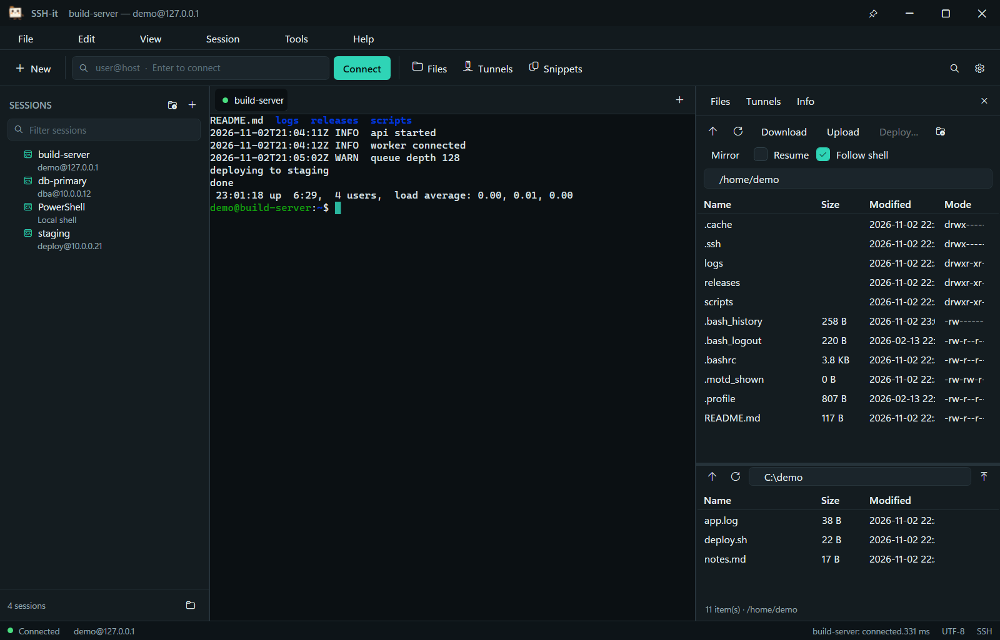

# SSH-it

**A native SSH workspace for Windows.**

SSH-it is a Windows program for people who live in SSH all day. It drives the
OpenSSH client that already ships with Windows, so every key type, every
`ProxyJump` chain and every line of your `ssh_config` behaves exactly as it does
in a terminal — because it *is* the same client. No bundled SSH stack to drift
from OpenSSH, no account, no cloud.



## What it does

**Sessions you own.** Hosts live in plain JSON under `%APPDATA%\SSH-it`, or next
to the executable if you drop an empty `SSH-it.portable` file beside it. Import
your existing `~/.ssh/config` (including `Include`) or your saved PuTTY sessions
in one click. Export everything to a file, put that file in OneDrive or git, and
you have sync without a subscription.

**A real terminal.** ConPTY host, full VT parser (truecolour, scroll regions,
alternate screen, bracketed paste, DEC line drawing, wide characters, OSC titles
and working-directory reporting), scrollback with search, selection, and eight
built-in colour schemes. Tabs, per-tab status dots, and a proper cursor.

**Themes that stay out of the way.** Dark and Light can follow Windows or be
pinned, and there are five more palettes in `View → Theme`: Slate (cool grey-blue),
Graphite (charcoal and brass), Fjord (deep teal), Parchment (warm paper, for
daylight) and Ink (near-black navy). The switcher applies them live, tabs and
title bar included, and remembers the choice. Windows high contrast is honoured
on top of all of them: when it is on, SSH-it uses your scheme's own colours,
draws selection and search hits as frames instead of washes, and never relies on
a hue to carry meaning. `View → Theme → High contrast` pins it even when Windows
is not in that mode.

**Files, on the same engine.** The Files panel speaks SFTP over the OpenSSH
`sftp` subsystem, so it inherits your agent keys and `ProxyJump` chains instead
of asking for credentials again. Browse, upload, download, drag files in from
Explorer, create folders, rename, delete, chmod. Transfers show progress, and
reads and writes run 32 deep in flight, so a transfer is limited by the link
rather than by latency: 16 MB over a 15 ms hop moved at 7.8 MB/s, against the
2.1 MB/s a one-request-at-a-time client is capped at, and matched OpenSSH's own
`sftp` on the same hop (2.65 s against 2.66 s). With shell integration installed
the panel also follows the shell: `cd /var/log` moves the listing there, and
*Upload* lands in the directory you are looking at. *Follow shell* in the toolbar
turns that off and leaves the panel wherever you navigated it.

**Edit remote files without leaving the app.** Right-click a file in the Files
panel and choose *Edit remote file* — SSH-it downloads it, opens it in whatever
editor you use, watches the local copy, and uploads it back every time you save.

**Record what happened.** Turn on *Record sessions* in Options and every session
is written as an asciinema v2 `.cast` file under `%APPDATA%\SSH-it\recordings`.
Replay it in the app — `Tools → Play recording…` opens a player with a timeline,
play/pause, 0.5× to 4× speed and seeking, so a session can be scrubbed frame by
frame instead of watched in real time. The files are plain asciinema v2, so
`asciinema play` still works too.

**Split panes, and type into both.** Split a tab right (`Ctrl+Shift+D`) or down
(`Ctrl+Shift+E`) and run a second shell beside the first — tail logs while you
work, or watch two hosts at once. `Ctrl+Shift+B` turns broadcast input on: every
keystroke then reaches every pane in the tab, and each armed pane gets a red frame
so you can see it from across the room. `Ctrl+Shift+Q` closes the focused pane.

**Read through it, or park it.** `Ctrl+scroll` fades the window so you can read
and type against a document behind it, and `View → Pin to desktop` parks the
window at the bottom of the z-order so other apps stay in front until you
click it.

**tmux, as one window.** Save a session with the *tmux* kind and SSH-it attaches to it
with `tmux -C`: every tmux pane becomes a pane in the window, laid out the way tmux laid
it out. Split on the far end and the window redraws to match, keys go to the pane you
clicked, and scrollback survives the rebuild. The panes are ordinary terminal panes, so
find, copy, paste, themes and session lock all still work, and the same window opens a
local session in WSL. It needs tmux 3.0 or newer on the far end — `%pause` and
`refresh-client -A` are what make a control-mode pane usable, and both arrived in 3.0 —
and an older tmux is refused by name and version instead of leaving a dead window.

**Pull a tab out.** `Ctrl+Shift+M` (or Session ▸ Move tab to a new window)
moves a tab, panes and all, into its own window. The session keeps running
through the move — it is the same terminal process and scrollback, not a
reconnect — and closing that window ends it.

**Run more than one window.** `Ctrl+Shift+N` (File ▸ New window) opens an
independent window with its own tabs and placement, sharing the same sessions,
keys and settings. Closing one window leaves the others and their shells running,
and the next launch restores the windows you had, each with its own tabs. A
shortcut or jump-list click aimed at a running SSH-it is handed to it instead of
starting a second copy: it opens the session in the window that last had focus.

**Command blocks.** Prepare the far shell once with the shell-integration snippet
(Tools ▸ Shell integration script): each command then becomes a block. The prompt row
gets a faint wash, a dot at the right edge shows success (green) or failure (red), and
the pane menu copies the last command (`Ctrl+Shift+U`), its output (`Ctrl+Shift+O`), or
both — the exact command line, not
a screen scrape, when the shell reports it. `Ctrl+Shift+Up` / `Ctrl+Shift+Down` jump
between prompts without hunting through scrollback.

**Resize without losing the line.** Long lines rewrap when the window changes width:
narrowing splits them and widening joins them back, with the cursor staying on its
text and double-width characters never cut from their continuation. Full-screen
programs (vim, htop, less) still get a plain resize, because they redraw anyway.

**Watch the host breathe.** The Host information panel keeps reading while it is
open: load average is sampled every five seconds and drawn as a small sparkline
with the current value, the peak and the sample count. Under it, a second chart
follows CPU and memory as percentages on a fixed 0-100 axis, read from the same
single ssh call. Sampling stops when the panel is hidden, so idle tabs cost
nothing; it applies to remote sessions only.

**See the jump chain.** A session that goes through jump hosts draws its route in the
Host information panel: you, each hop, then the target. When a connection fails,
the hop ssh's own error names is the one that gets marked, with the message
underneath it — and if the error names no host at all, the panel says the failure
is somewhere in the chain instead of guessing. Chains typed with spaces after the
commas are tidied; a chain with keys is spelled as nested `ProxyCommand`s rather
than `-J`, because `-J` never passes your key file to the hop.

A hop can carry a key of its own: put it after an `=`, in the same jump field as
`hop=path`, comma-separated — `ops@jump-a:2222=C:\keys\jump-a, ops@jump-b=C:\keys\jump-b`.
Each stage then gets its own `-i` and `IdentitiesOnly`, so a bastion sees only the
key meant for it and the target sees only its own. A hop with no key falls back to
the session's key, and then to your agent.

**X11 without the guesswork.** Tick *Forward X11* on a session and SSH-it looks for a
local X server on displays :0 to :5, tells you in the editor whether one is
running, and sets `DISPLAY` for the ssh child — Windows OpenSSH does not do that
for itself, which is why `-X` so often connects and then fails on the first remote
GUI program. If nothing is listening, the pane says so when the session connects,
instead of letting `xclock` fail with a confusing message.

**Readable by screen readers.** The terminal is a custom-drawn surface, so it
publishes itself to Windows accessibility as a Document with a full TextPattern:
NVDA and Narrator can read the visible screen, move by character, word, line and
paragraph, and select text. A range selected through UIA lands on the same
selection the mouse makes, so it highlights where it is read, and each range
reports bounding rectangles a reader can follow. A text-change event fires as
output arrives.

**Tunnels that stay up.** Local, remote and dynamic forwards as saved rules,
started as `ssh -N` processes that survive a session restart and report their
state in the panel.

**Files without SFTP.** `sz file` on the far end starts a ZMODEM transfer and the
terminal takes the stream over: the file lands in your Downloads folder under its
own name, with a progress line in the status bar, and the shell comes back
afterwards. Session ▸ *Send file over ZMODEM* arms the other direction — pick a
file, run `rz` on the far end. This is for telnet, serial and BBS-style hosts,
where there is no SFTP to reach for. Transfers are CRC-checked both ways, a name
that tries to leave the download folder is reduced to a leaf name, and a
`ZCOMMAND` frame is refused rather than obeyed.

**Keys without the ritual.** List the keys in `~/.ssh`, read fingerprints, copy
the public half, and generate a new ed25519 key from the Key manager.

**Small things that matter.** Windows Credential Manager for saved passwords
via an `SSH_ASKPASS` helper (the secret never sits in a config file), a local
PowerShell tab for when you just need a shell, quick connect (`user@host:port`),
the standard Windows jump list of recent hosts, a tray icon, and per-monitor DPI.

## Quick start

1. Install `SSH-it-Setup-1.0.31.exe` (per-user, no admin prompt).
2. `File → Import from OpenSSH config`, or press `Ctrl+K` and type `user@host`.
3. Double-click a host. That is it.

Requires Windows 10 1809 or newer. The installer is self-contained: no .NET
runtime to install.

## Keyboard

| Keys | Action |
| --- | --- |
| `Ctrl+N` | New session |
| `Ctrl+Shift+N` | New window |
| `Ctrl+Shift+L` | Local terminal |
| `Ctrl+K` | Quick connect |
| `Ctrl+Shift+T` / `Ctrl+Shift+W` | New tab / close tab |
| `Ctrl+Shift+D` / `Ctrl+Shift+E` | Split pane right / down |
| `Ctrl+Shift+Q` | Close the focused pane |
| `Ctrl+Shift+B` | Broadcast keystrokes to every pane in the tab |
| `Ctrl+Shift+M` | Move the tab into its own window |
| `Ctrl+Tab`, `Alt+1…9` | Move between tabs |
| `Ctrl+Shift+C` / `Ctrl+Shift+V` | Copy / paste |
| `Ctrl+F` | Find in scrollback |
| `Ctrl+Shift+F` | Files panel |
| `Ctrl+Shift+U` / `Ctrl+Shift+O` | Copy the last command / its output |
| `Ctrl+Shift+Up` / `Ctrl+Shift+Down` | Jump to the previous / next prompt |
| `Ctrl+Shift+S` | Host information |
| `Ctrl+=` / `Ctrl+-` / `Ctrl+0` | Zoom |
| `Ctrl+scroll` | Fade the window so text behind it can be read (persists) |
| `F11` | Full screen |

## Agents and scripting

The same sessions, keys, jump hosts and saved passwords the window uses are
available headlessly:

```
ssh-it --sessions --json
ssh-it --exec <session> "<command>" --json        # stdout, stderr, exit code
ssh-it --sftp-list <session> <path> --json
ssh-it --sftp-get <session> <remote> <local>
ssh-it --sftp-put <session> <local> <remote>
ssh-it --tunnel-up <session> L:127.0.0.1:8080:localhost:80 --json
ssh-it --tunnel-list --json
ssh-it --tunnel-down <id|spec>
ssh-it --mcp                                      # stdio MCP server
```

`<session>` is an id, a name or a host as shown in `--sessions`. The MCP server
exposes the same verbs as `ssh_exec`, `sftp_list`, `sftp_get`, `sftp_put`,
`sessions_list` and the three tunnel tools, so an agent can work through your jump
chains without holding
keys of its own. It speaks JSON-RPC on stdin/stdout and opens no port.

A tunnel started from the command line is not owned by the command: `ssh -N` is
started detached and recorded with its pid, so it keeps running after the command
exits and `--tunnel-list` can find it later. There is no auto-restart — a tunnel
that dies stays dead, and the list stops claiming it. Forward specs are
`L:bind:port:host:port`, `R:...` and `D:bind:port`.

If you want the surface reachable by agents but not by everything running as you,
turn on the agent gate in Settings and tick *Allow agent commands* on the hosts an
agent may use. With the gate on, a verb aimed at any other host exits 3 with
`blocked: …` instead of connecting. It is off by default, so nothing changes until
you ask for it.

## Privacy & safety

**No telemetry, no account, no network calls except the ones you ask for.**
Sessions are JSON files on your disk. Passwords you choose to save go to Windows
Credential Manager under the current user; they are never written to the session
file. Private keys stay wherever `ssh` expects them — SSH-it only reads public
halves for fingerprints.

Host keys are verified by OpenSSH itself, with the same `known_hosts` file your
terminal uses. There is no "ignore host key" switch hidden in a dialog.

## Self-test

The terminal core has a headless regression suite:

```
SSH-it.exe --selftest
```

It exits 0 on success and writes `%APPDATA%\SSH-it\logs\selftest.txt`. The suite
is 500 checks (plus the PowerShell module's 10) and covers cursor addressing,
wrapping, scrollback, alternate screen, SGR colours, wide characters, DEC graphics,
save/restore, OSC titles, shell-integration marks, the agent surface, leases,
policy, the ledger, sync, deploy and the bench arithmetic. One check skips under a
no-console launcher: the ConPTY round-trip, which needs a real console.

## Performance

Two measurements, both honest about what they measure:

```
SSH-it.exe --bench [--json] [--compare old.json]
```

`--bench` runs three seeded in-process corpora (ASCII, CSI-heavy, UTF-8) through the
parser, 5 runs after a discarded warm-up, and reports median, p95 and sigma. It
records the preconditions (AC power, other instances, refresh rate, CPU, OS) instead
of enforcing them, and `--compare` turns a slowdown into a percentage. Parse MB/s is
the parser alone — bytes in, buffer state out — never session throughput.

Tools → Performance is the live instrument: keystroke → painted echo p50/p99, frame
interval with a 1.5×-median drop count, paint cost, parser drain and backlog, memory
including the session's ssh children, and startup to first frame. It stops sampling
while hidden.

Numbers from the development machine (v1.0.30, 100 Hz display at 120 DPI, local
PowerShell, 2026-11-01):

- keystroke → painted echo: **17.9 ms p50, 97.3 ms p99** (n=8 real keys; the panel
  prints its sample count, because PSReadLine batches its echo)
- frame interval: 15.7 ms p50, 26.3 ms p99, 2.0% over 1.5× the median
- paint (OnRender): 0.05 ms p50
- parser: 3.0 MB/s ASCII, 7.4 MB/s CSI-heavy, 2.0 MB/s UTF-8 (median of 5)

The echo figure ends at the paint that shows the echo, not at the photon, and no
other-app comparison is claimed: the same-machine Windows Terminal number has not
been measured with the same method.

## Building from source

```
dotnet build src/SshIt/SshIt.csproj -c Debug
dotnet publish src/SshIt/SshIt.csproj -c Release -r win-x64 --self-contained true \
  -p:PublishSingleFile=true -p:IncludeNativeLibrariesForSelfExtract=true -o src/SshIt/publish
```

Installer (Inno Setup 6):

```
"%LOCALAPPDATA%\Programs\Inno Setup 6\ISCC.exe" installer\setup.iss
```

The UI is WPF on .NET 9 with no third-party packages. The terminal renderer is
custom: per-line drawing groups cached by content version, so typing repaints one
line rather than the screen.

## What is not here yet
Being honest about the gap between "works" and "wins":

- Mosh persistence. There is no native Windows mosh client, so the plan is to use
  a `mosh.exe` you already have rather than bundle a second transport stack.
- An ARM64 build. It publishes, but it has not been run on ARM64 hardware, and an
  installer that was never exercised is not worth shipping.
- Signed auto-update. The pipeline and the update manifest are the easy half; a
  code-signing certificate is the part that costs money.

These are the next things, in roughly that order.

## Contact

Issues and questions: [github.com/ModdySwag/SSH-it/issues](https://github.com/ModdySwag/SSH-it/issues) or admin@moddys.net.

## Licence

MIT.

Cheers Moddy!
